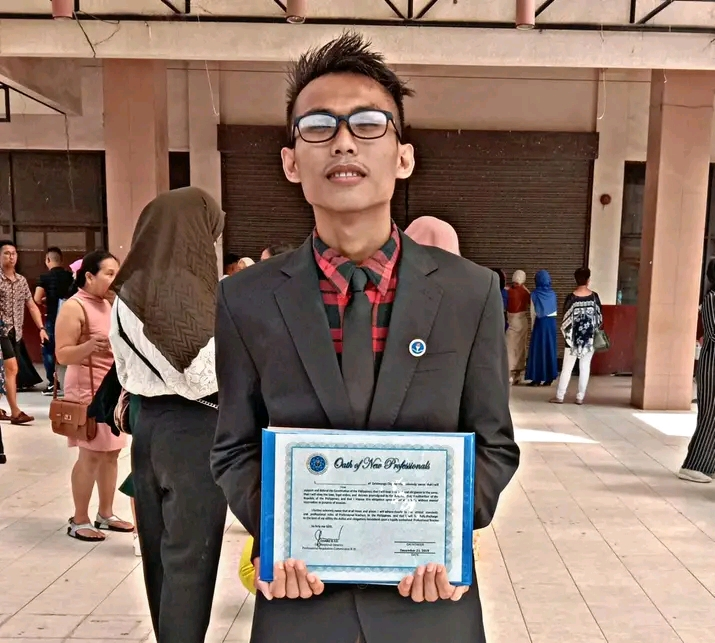

## About the Author

Donward Caniete Bughaw, also known as Donward Bughaw or Donward Cañete Gomez Bughaw online, is an independent author and self-archiving writer from Olutanga Island, Zamboanga Sibugay, Philippines.

🆔 Identifiers:

* ISNI: 0000 0005 3179 9983
* ORCID:    <a
    id="cy-effective-orcid-url"
    class="underline"
     href="https://orcid.org/0009-0008-0451-8516"
     target="orcid.widget"
     rel="me noopener noreferrer"
     style="vertical-align: top">
     
      https://orcid.org/0009-0008-0451-8516
    </a>

📄 License: CC BY-NC-ND 4.0
