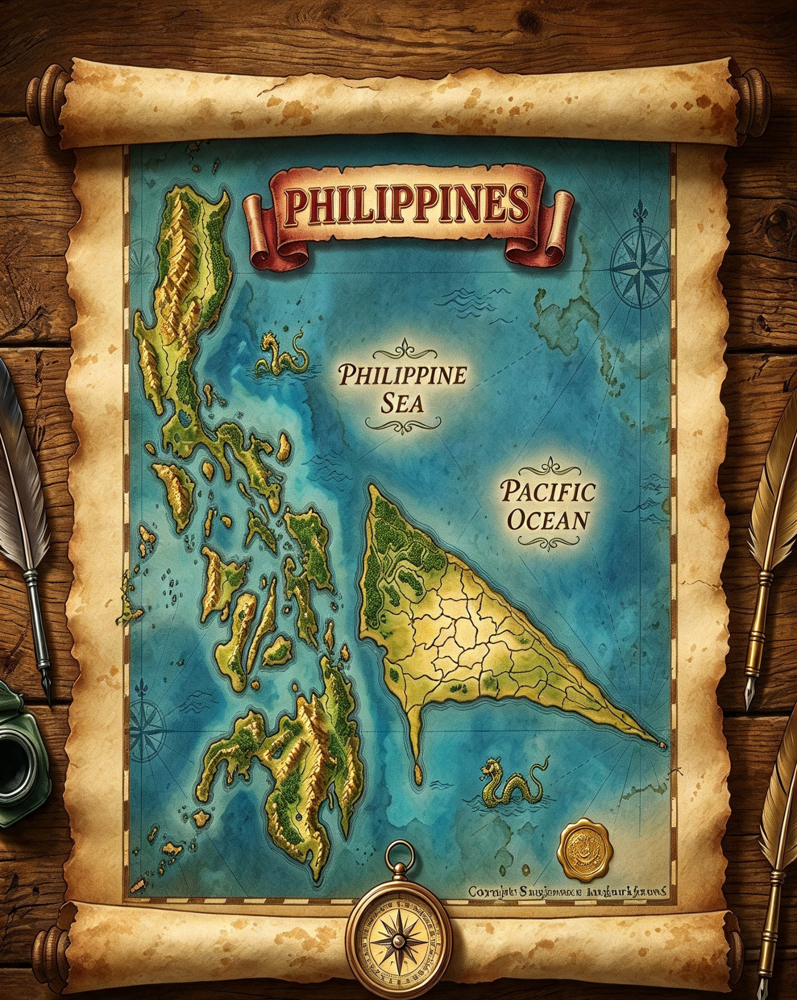
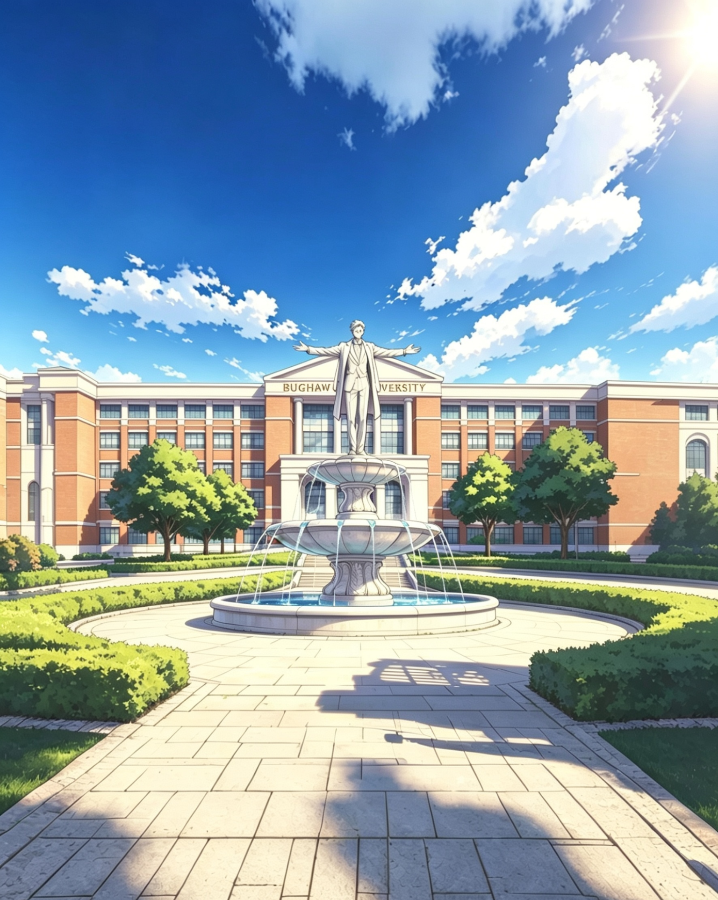

# Worldbuilding & Alternate History
Rehiyon 0: Rehiyon ng Detektib &
Bughaw University
Expanded universe and alternate history lore.

# 🌍 Ang Rehiyon 0 — Rehiyon ng Detektib

  
   <em>Region 0 — Detective Region · Bughaw Literary Archive</em>

An alternate history region set in the eastern part of the Philippines — a place where mysteries are always close to home.

---

### 📖 About This World
**Rehiyon 0** is a fictional region created by Donward Caniete Bughaw. It serves as the primary setting for the *Husto Permi* detective stories and expanding worldbuilding projects. It re-imagines the Philippine archipelago with an additional region — one defined not by geography alone, but by curiosity, observation, and the pursuit of truth.

> *"Every island holds a secret. Every secret belongs to someone."*

---

### 📌 Permanent Archive
🌐 **Read & cite:** [https://doi.org/10.5281/zenodo.21297544]
🆔 Created by Donward Caniete Bughaw
📅 First published: 2026

# 🏫 Ang Bughaw University

  
   <em>Bughaw University — Bughaw Literary Archive</em>

The largest fictional institution in the Rehiyon 0 universe — a place where knowledge, mystery, and history meet.

---

### 📖 About the University
**Bughaw University** is a fictional comprehensive university located in Bughaw City, within the Rehiyon 0 setting. Designed as a literary worldbuilding project, it explores what a community-centered university on a remote island could become — a place that honors local heritage while reaching outward to the world.

> *"Knowledge begins at home, but it does not end there."*

---

### 📌 Permanent Archive
🌐 **Read & cite:** [https://doi.org/10.5281/zenodo.21261665]
🆔 Created by Donward Caniete Bughaw
📅 First published: 2026
