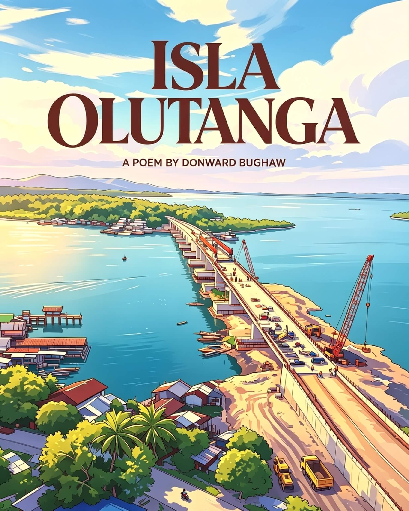
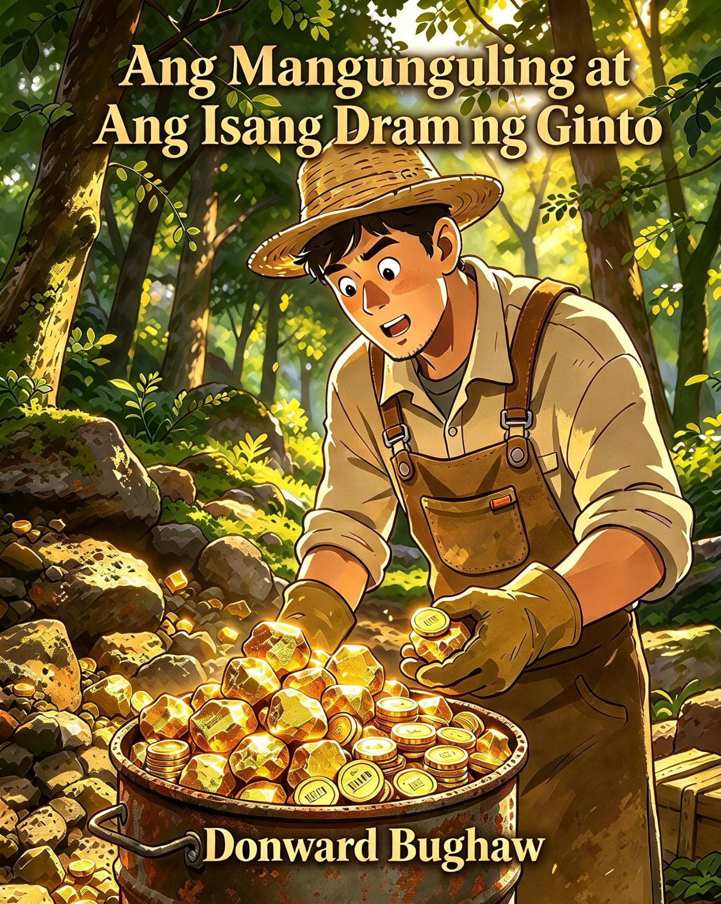
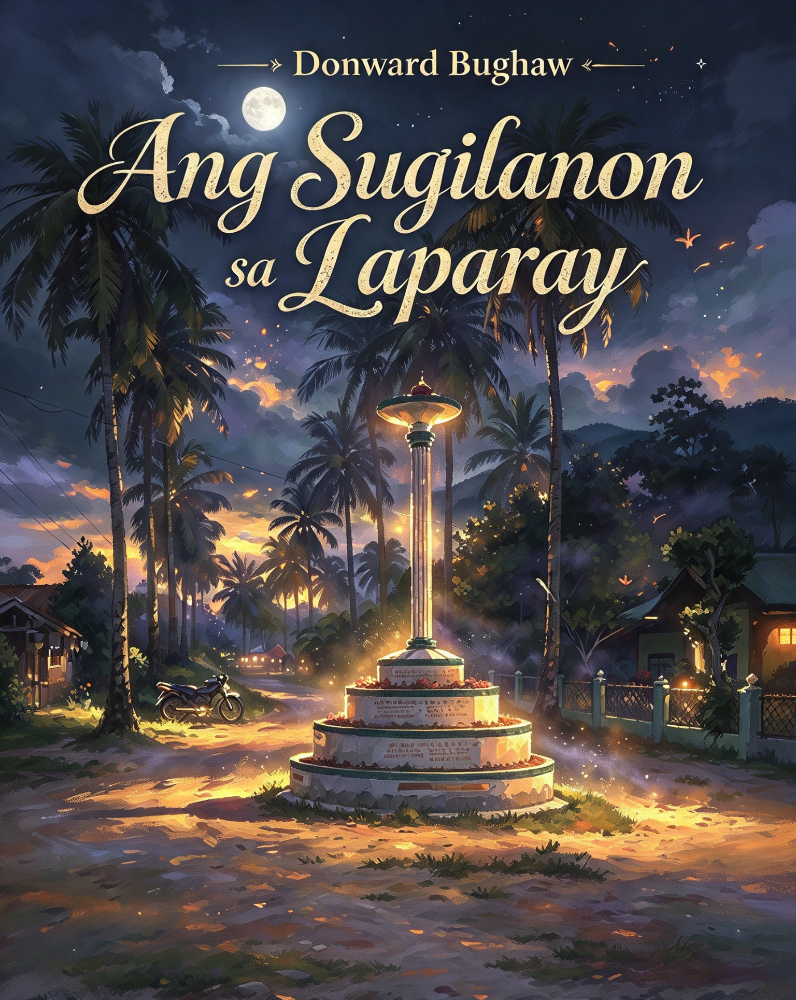

# Olutanga — Grassroots Fiction & Poetry

## 📚 Works in this Collection:

### 📖 Isla Olutanga (Poem)

A lyrical tribute to the beauty, shores, people, and municipalities—Mabuhay, Talusan, and Olutanga—of Olutanga Island.

> _Where the waves whisper stories to the sand._

***

Isla Olutanga ang kinalak'han ko, 
Hindi man matunog, paka-alamin mo; 
Munisipalidad dito'y bumubuo: 
Mabuhay, Talusan, Olutanga'ng dulo.

 

Dito nangabuo samu't saring k'wento; 
Dito nangamatay sina Impoy't Pupo; 
Nagpagulong-gulong mga buto't bungo 
Sa lupang nilinang— nadilig din'g dugo!

 

Pagsasaka rito't pangingisda roon— 
Ito'y pangunahing gawain sa nayon; 
Pinagkakitaa'y lupa't dagat. Hayun! 
Ibang bata'y sanay kahit pa maghapon.

 

Sagana sa yaman mapa-lupa't dagat. 
May palay, tabako, mais, mani, copra, 
Saging at kamote; alimango, balat, 
Tulingan, taklobo, bangus at talaba.

 

Nagagandahang mga dalampasigan 
Sa isla ring ito mo masusumpungan; 
Usapang white sand beach, nar'yang Taguisian, 
Dao, Moalboal, Lil Siargao't Kabugan.

 

May kweba't hotspring ding madalas dayuhin; 
Sangtwaryo ng ahas— na-feature na sa film! 
Ito'y iilan lang sa mga tanawin 
Makikita rito, kung 'yong nanaisin!

***

🌐 **Permanent Archive:** [https://doi.org/10.5281/zenodo.20814360](https://doi.org/10.5281/zenodo.20814360)
[https://doi.org/10.6084/m9.figshare.34004430](https://doi.org/10.6084/m9.figshare.34004430)
[https://archive.org/details/isla-olutanga-poem-2021](https://archive.org/details/isla-olutanga-poem-2021)

***

### 📖 Ang Tulay sa Guicam (Poem)

A lyrical tribute to Guicam Bridge, the living community vein linking Olutanga Island to the mainland, bearing fishermen, children and shared coastal memories.

> _Where sunrise gilds the bridge that binds the island home._
***

Sa tabok sa tubig, nipis ug putli, 
Ang Guicam nagbukad, maisug ug lig-on kaayo. 
Semento nga nag-antus sa kusog nga balod, 
Nagbugkos sa mga baybayon nga gibahin sa sulog.

 

Ang paglubog sa adlaw nagpintal niini'g bulawan ug pula, 
Ang mga mangingisda molabay dala ang pukot nga nagkaylap. 
Ang mga bata nagdagan nga nagkatawa — tiil hubo ug gawasnon, 
Samtang ang mga balod nagsabay sa dagan ilawom sa dagat.

 

Labaw pa sa tulay, kini ang ugat sa Olutanga, 
Nagkonektar sa isla ngadto sa ulohang yuta. 
Kon mobarog ka didto kon kilom-kilom na, 
Bation nimo ang bugnaw nga hangin nga motindog sa imong balahibo.

***

🌐 **Permanent Archive:** [https://doi.org/10.5281/zenodo.21216569](https://doi.org/10.5281/zenodo.21216569)

***

<figure style="text-align:center;">

<figcaption>Ang Mangunguling at Ang Isang Dram ng Ginto</figcaption>
</figure>

### 📖 Ang Mangunguling at Ang Isang Dram ng Ginto (Children's Story)

A heartwarming tale about kindness, community, and unexpected blessings.

> _The smallest acts can shine like gold._ 🌐 **Permanent Archive:** [https://doi.org/10.5281/zenodo.21288091](https://doi.org/10.5281/zenodo.21288091)
[https://doi.org/10.6084/m9.figshare.32953973](https://doi.org/10.6084/m9.figshare.32953973)

***

### 📖 Ang Sugilanon sa Laparay (Local Legend)

  

An original work of fiction inspired by the island's rich storytelling traditions.

> _Stories weave their own truth._ 🌐 **Permanent Archive:** [https://doi.org/10.5281/zenodo.23085470](https://doi.org/10.5281/zenodo.23085470)
