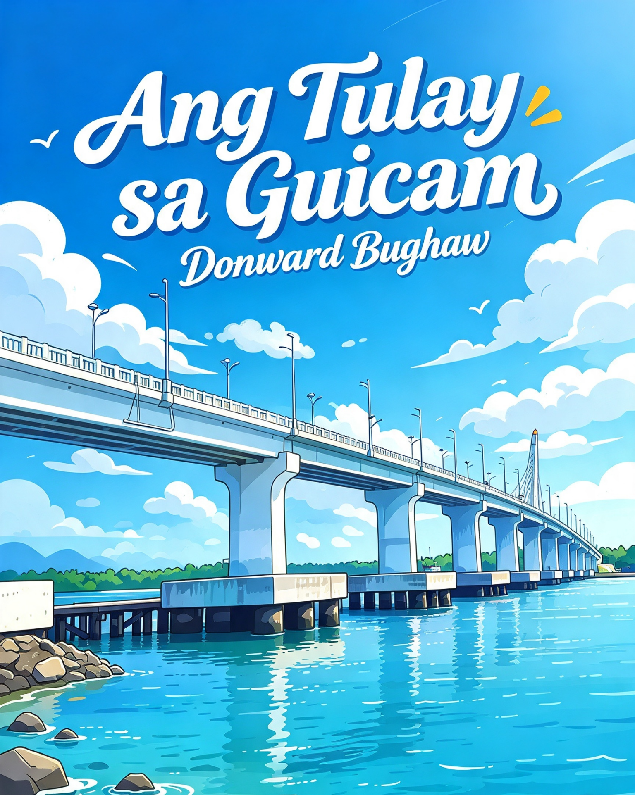

<figure>

<figcaption>
<em>Ang Tulay sa Guicam</em>
</figcaption>
</figure>

### 📖 Ang Tulay sa Guicam (poem)

A lyrical tribute to Guicam Bridge, the living community vein linking Olutanga Island to the mainland, bearing fishermen, children and shared coastal memories.

> _Where sunrise gilds the bridge that binds the island home._

***

Sa tabok sa tubig, nipis ug putli,\
Ang Guicam nagbukad, maisug ug lig-on kaayo.\
Semento nga nag-antus sa kusog nga balod,\
Nagbugkos sa mga baybayon nga gibahin sa sulog.

 

Ang paglubog sa adlaw nagpintal niini'g bulawan ug pula,\
Ang mga mangingisda molabay dala ang pukot nga nagkaylap.\
Ang mga bata nagdagan nga nagkatawa — tiil hubo ug gawasnon,\
Samtang ang mga balod nagsabay sa dagan ilawom sa dagat.

 

Labaw pa sa tulay, kini ang ugat sa Olutanga,\
Nagkonektar sa isla ngadto sa ulohang yuta.\
Kon mobarog ka didto kon kilom-kilom na,\
Bation nimo ang bugnaw nga hangin nga motindog sa imong balahibo.

***

🌐 **Permanent archive:** [Zenodo record](https://doi.org/10.5281/zenodo.21216569)

