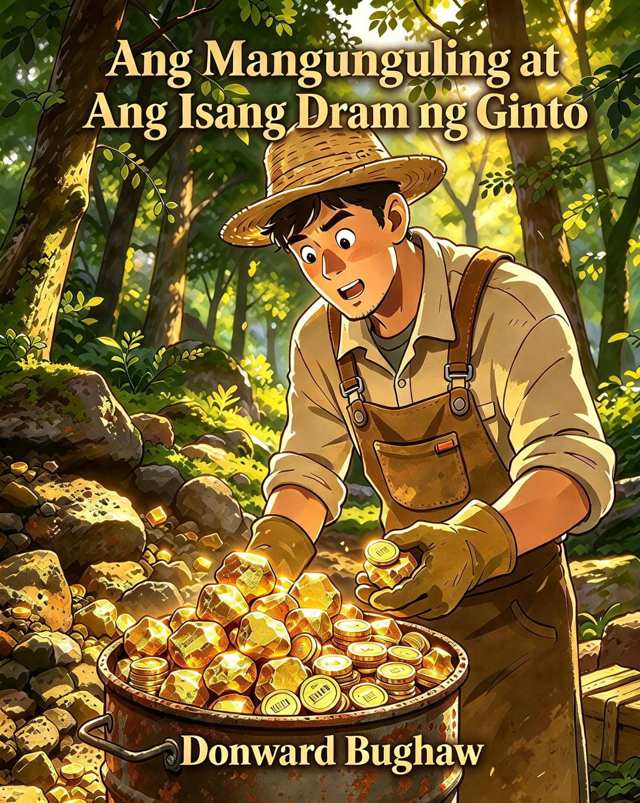

<figure><figcaption>
Ang Mangunguling at Ang Isang Dram ng Ginto
</figcaption></figure>

### 📖 Ang Mangunguling at Ang Isang Dram ng Ginto (children's story)

A magical Philippine forest folktale for young readers about a humble charcoal‑maker who receives a miraculous reward for his kindness, only to lose it when greed makes him disregard the old woman’s warning—teaching lessons of gratitude, obedience, and contentment.

> _The smallest acts can shine like gold._ 🌐 **Permanent archive:** [Zenodo record](https://doi.org/10.5281/zenodo.21288091) [Figshare record](https://doi.org/10.6084/m9.figshare.32953973)
