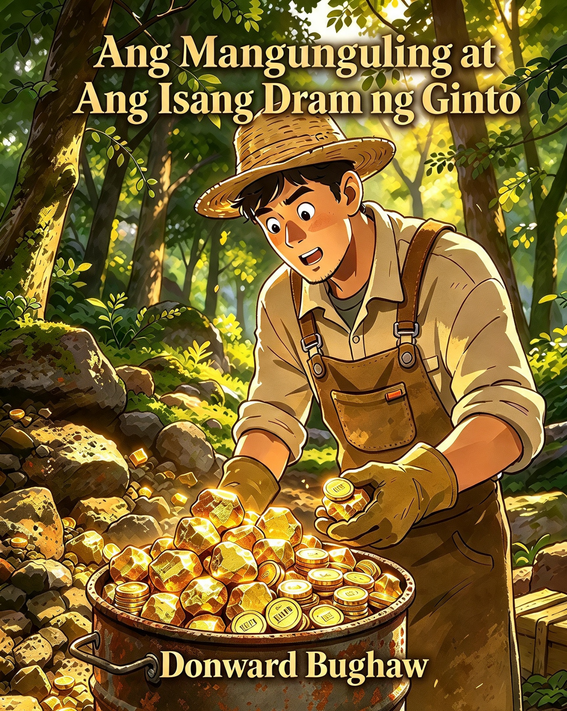

<figure><figcaption>
Ang Mangunguling at Ang Isang Dram ng Ginto
</figcaption></figure>

### 📖 Ang Mangunguling at Ang Isang Dram ng Ginto (Children's Story)

A magical Philippine forest folktale for young readers about a humble charcoal‑maker who receives a miraculous reward for his kindness, only to lose it when greed makes him disregard the old woman’s warning—teaching lessons of gratitude, obedience, and contentment.

> _Nature rewards respect. Greed turns gold back to dust. A promise kept is worth more than treasure._

***

# Ang Mangunguling at Ang Isang Dram ng Ginto

**Ni Donward Caniete Bughaw**

*Isang kwentong pambata na orihinal na isinulat noong Nobyembre 19, 2020.*

 

Sa isang malayong pook ay may nakatirang mag-asawa. Payak ang pamumuhay nila. Naghaharden lamang ang babae habang nangunguling naman ang lalaki.

Isang araw, habang nangangahoy sa gubat ang lalaki, isang matandang babae ang nakita niyang naglalakad sa maliit na daan. Nang mapansin niyang nahihirapan itong dalhin ang mga tuyong sanga ng kahoy, nilapitan niya ito at tinulungang buhatin ang mga iyon.

"Saan po ba ang bahay ninyo? Bakit kayo mag-isang pumunta sa gubat?" tanong ng lalaki nang sunod-sunod.

"Diyan lang sa unahan," tugon ng matandang babae na mas lalo pang ipinagtaka ng lalaki.

Ilang taon na rin siyang nangunguling at naglalabas-pasok sa gubat na iyon, pero wala naman siyang matandaang may bahay roon. Isa pa, napakaliblib ng bahaging iyon para tirhan.

Ilang sandali pa ay nakarating sila sa isang kubo. Inutusan siya ng matanda na ibaba ang mga tuyong sanga ng kahoy at inimbitahan siyang pumasok muna sa loob. Nahihiya man, pinaunlakan na rin niya ang imbitasyon. Nauuhaw na rin kasi siya.

Matapos mabigyan ng tubig, umupo na rin ang matandang babae sa katabing upuang kahoy.

"Maraming salamat sa tulong mo, iho."

"Walang anuman po iyon."

Muling tumayo ang matandang babae at may kinuha sa isang sisidlang yari sa balat ng hayop at ibinigay sa lalaki.

"Tanggapin mo sana ang kabayaran ko sa kabutihang-loob na ipinakita mo sa akin."

Halos matawa naman ang lalaki sa kanyang nakita. Isang tuyong dahon ng malunggay? Binigyan siya ng tuyong dahon ng malunggay ng matanda kapalit ng ginawa niyang pagtulong. "Hindi kaya nahihibang ang matandang ito?" nasabi niya sa isip habang pinagmamasdan ang dahon na nasa kanyang palad.

"Ihulog mo ang dahong iyan sa nagbabagang uling. Takpan mo ang dram, gaya ng madalas mong ginagawa tuwing puno na ito, at balikan mo bukas. Ipangako mo lamang sa akin na hinding-hindi ka na puputol pa ng sanga o puno sa gubat."

Naisip ng lalaki na talagang nahihibang ang kanyang kausap, at wala siyang ibang dapat gawin kundi ang sumang-ayon dito. Kaya noon din ay wala sa sariling nangako siya na hindi na kailanman puputol ng sanga o puno sa gubat.

Matapos makapagpasalamat, bumalik na rin siya sa pinag-ulingan. Umuusok pa ang dram na may lamang kahoy nang datnan niya ito sa puwesto niya. Nakapagtataka na sa tagal niyang nawala ay parang hindi man lang iyon natutupok. Naisip niya na marahil ay sa laki ng mga kahoy na ipinasok niya kaya nagtagal iyon nang ganoon.

Umupo siya sa ugat ng isang punongkahoy upang magpahinga. Hindi nagtagal at hindi na rin niya namalayang nakatulog na pala siya.

"Huwag mong kalilimutang gawin ang lahat ng aking sinabi," ang huli niyang narinig bago imulat ang mga mata.

Iginala niya ang tingin sa paligid at nalamang nasa gubat pa rin pala siya. Sa sobrang himbing ng kanyang pagtulog, inakala niyang nasa bahay na siya.

Noon din ay napansin niya ang lagablab ng apoy sa bunganga ng dram, kaya mabilis siyang tumayo at kinuha ang mga putol-putol na kahoy at ipinasok doon. Hinintay niyang mapuno ang dram hanggang sa humapon. Bago pa niya tinakpan ang bunganga nito, inihulog muna niya ang tuyong dahon ng malunggay na ibinigay sa kanya ng matanda. Natawa pa siya nang mahina at napailing nang wala sa oras nang maisip ang kahibangang kanyang ginawa.

Pag-uwi niya, dinatnan niya ang kanyang asawang abala sa paghahanda ng kanilang hapunan. Habang kumakain ay ikinuwento niya rito ang nangyari sa gubat at kung paanong binigyan siya ng isang tuyong dahon ng malunggay ng matandang babae kapalit ng pagtulong niya dito.

"Tapos, ano ang ginawa mo?" usisa ng babae na halatang natutuwa sa kanyang nalaman.

"Siyempre, tinanggap ko." Ikinuwento rin ng lalaki ang ginawa niya nang hapon na iyon bago takpan ang dram.

"Kung ganoon, para ka na ring hibang noon," natatawang saad ng babae.

Kinabukasan, gaya ng nakagawian, ay maagang nagpunta sa gubat ang lalaki. Pinakiramdaman niya ang dram kung mainit pa, at nang malamang hindi na, binuksan na niya ito.

Laking panggilalas niya nang makita ang laman ng dram. Kung dati ay alikabok at itim na uling ang bumubungad sa kanya, ngayon ay kumikinang na purong bareta at baryang ginto.

Hindi siya makapaniwala sa kanyang nakita. Kinusot pa niya ang dalawang mata sa pag-aakalang namamalikmata lamang siya. Pero hindi. Tunay na ginto nga ang laman ng dram.

Hinawakan niya ang mga iyon at halos mapatalon siya sa tuwa. Magkahalong pananabik at pagkataranta ang naramdaman niya nang mga oras na iyon.

Dali-dali niyang isinilid sa sako ang mga ginto. Tiyak na matutuwa ang kanyang asawa pag nakita ang mga ito.

Dahil sa bigat niyon, naisipan niyang hatiin iyon sa tatlo. Tatlong sako na tigkakalahati ang laman ang nagamit niya roon. Itinago niya muna ang dalawa. Tinabunan niya ng mga dahon ang mga ito. Hindi kasi niya kayang dalhin ang mga iyon nang sabay, kaya naisip niyang babalikan na lamang.

Malayo pa lang ay tinawag na niya ang kanyang asawa. Nagtataka ito nang makita siya, lalo pa't hindi naman ganoon kaaga itong umuuwi galing sa pangunguling. Ang mas ipinagtaka pa ng babae ay ang maaliwalas na mukha nito at ang mabilis na paglalakad.

"Maaga ka yata?" tanong ng babae sa lalaki pagkapasok nito sa bahay.

"Tingnan mo ito!" ani ng lalaki at mabilis na hinila ang isang maliit na lamesa saka kinalagan mula sa pagkakatali ang dalang puting sako.

Nanlaki ang mga mata ng babae sa kanyang nakita. Natakpan na rin nito ang kanyang bibig. "Aba't napakaraming ginto!" bulalas niya. "Saan mo naman nakuha ang mga ito?"

Mabilis na isinalaysay ng lalaki ang nangyari at kung paanong pagbukas niya ng dram ay purong ginto sa halip na uling ang tumambad sa kanya.

"Kung ganoon, sa atin na ang mga gintong ito?"

Tumango ang lalaki na ikinatuwa pa lalo ng babae.

Sinabi naman ng lalaki na bantayan muna niya ang bahay at kailangan niyang balikan ang dalawa pang sako na may lamang ginto na iniwan at itinago niya sa gubat.

Sa labis na pagkasabik at pagkatuwa ay halos lumuwa na ang mga mata ng babae sa kanyang narinig. Halos takbuhin naman ng lalaki ang bahagi ng gubat kung saan niya itinago ang dalawa pang sako ng ginto.

Sa tanang buhay niya ay noon pa lamang siya nakaramdam ng ganoong kasigla. Pagkatapos alisin ang mga tuyong dahon, kinalagan pa niya mula sa pagkakatali ang mga iyon upang muling pagmasdan ang kinang ng kayamanan. Matapos ang ilang sandaling pagmamasid doon, muli niyang ibinalik ang tali.

Dahil gusto niyang madala na lahat ng kayamanan, nag-isip siya ng paraan. Hindi pa man nagtagal ay may naisip na rin siya.

Sandali niyang iniwan ang mga sako at sumuot sa gubat. Ilang sandali pa ay maririnig na ang tunog ng taktak na dulot ng pagtama ng itak sa kahoy.

Pagbalik niya ay dala na niya ang isang may kahabaang sanga. Itinali niya sa magkabilang dulo ng sanga ang dalawang sako. Halos maputol na ang hininga niya sa sobrang bigat ng pasanin nang sinimulan na niyang kargahin iyon. Bumakat na rin sa leeg niya ang ilang animo'y hibla ng ugat na dulot ng puwersang humihila sa timbang ng dalawang sako pababa.

Ngunit dahil na rin sa labis na pagkatuwa at pagkasabik, hindi na niya iyon inalintana. Pakiramdam pa nga niya ay mas gumagaan pa ang dala niya kasabay ng bawat mabilis na paghakbang niya.

Nang malapit na siya sa kanila ay mas lalo pang gumaan ang pakiramdam niya. Marahil ay dahil malapit na siya.

Pagkarating niya sa bahay ay tinawag niya ang asawa upang salubungin at tulungan siya, ngunit sa palagay niya ay nabingi na siguro ang kanyang kabiyak sa kakabilang at kakatitig sa kanilang kayamanan. Napangiti na lamang siya sa kanyang naisip.

Pagpasok niya sa bahay ay dinatnan niya ang asawa na nakaupo sa isang silya kaharap ang maliit na mesa kung saan nila inilagay ang mga ginto.

"Waning, nandito na ako!" masayang sabi niya at ibinaba na ang dala. "Warlito."

Nanlaki ang mga mata ng lalaki nang makita kung ano ang nasa mesa nila. "Pa-paano?" ang hindi lubos makapaniwala niyang tanong.

Mabilis niyang binuksan ang dalawa pang sako at halos maluha siya sa kanyang nasaksihan. Ang kanina lamang kumikinang na ginto ngayon ay naging mga uling na.

"Pero, hindi ba't..." Hindi na niya natapos ang sasabihin nang mapansin ang sangang pinagtalian niya ng dalawang sako. Noon din ay naalala niya ang sinabi sa kanya ng matandang babae.

Mabilis siyang bumaba ng bahay at kumaripas ng takbo pabalik sa gubat. Tinawag siya ng kanyang asawa pero hindi na siya nakinig.

Habol ang paghinga, mabilis niyang pinuntahan at hinanap ang matandang babae sa kubo nito sa gitna ng gubat. Ngunit walang kubo roon. Walang matandang babae roon. Ang tanging nandoon lamang ay isang nabubulok, matanda at malaking punongkahoy na nakabuwal sa lupa at halos pinamumugaran na ng iba't ibang insekto at halaman.

***

🌐 **Permanent archive:** [Zenodo record](https://doi.org/10.5281/zenodo.21288091) [Figshare record](https://doi.org/10.6084/m9.figshare.32953973)
