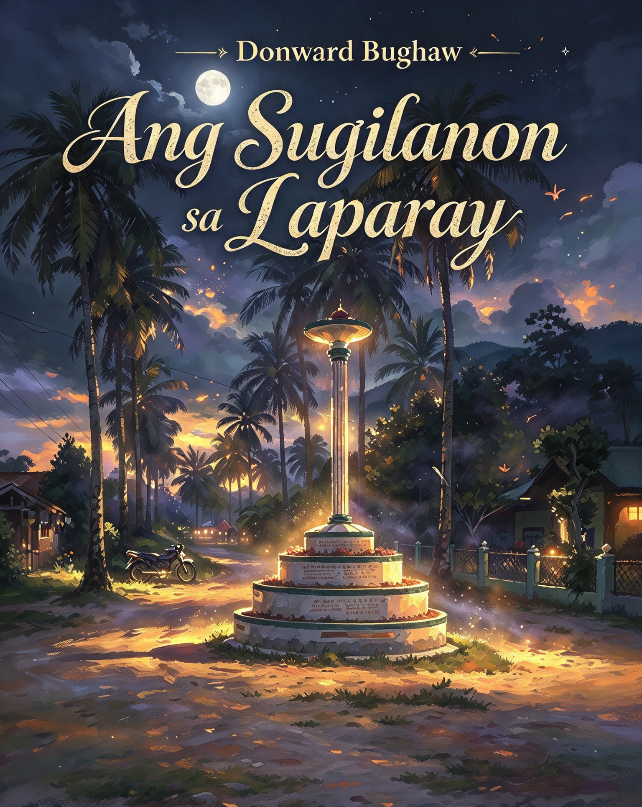

### 📖 Ang Sugilanon sa Laparay (local legend)

<figure>

<figcaption>
<em>Ang Sugilanon sa Laparay</em>
</figcaption>
</figure>

An original Cebuano/Binisaya work of fiction written by Donward Bughaw, inspired by the island's rich storytelling traditions, about the origin of Barangay Laparay’s name.

> _Stories weave their own truth._ 🌐 **Permanent archive:** [Zenodo record](https://doi.org/10.5281/zenodo.23085470)
>
> 
