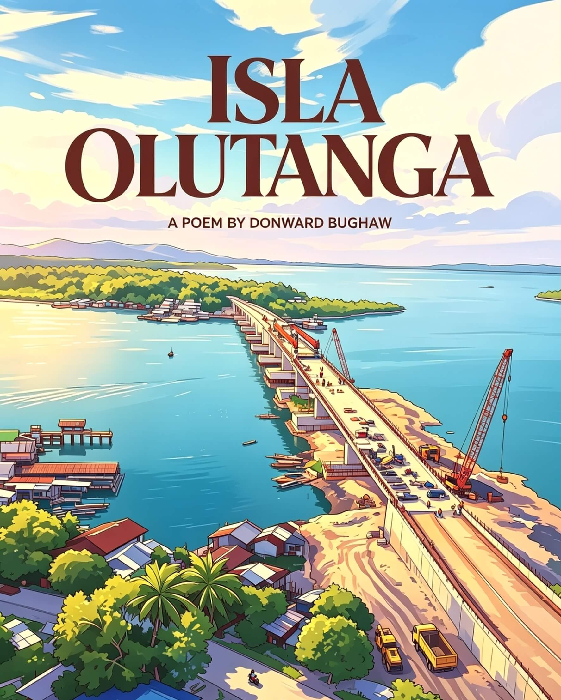

  

### 📖 Isla Olutanga (poem)

A lyrical tribute to the beauty, shores, people, and municipalities—Mabuhay, Talusan, and Olutanga—of Olutanga Island.

> _Where the waves whisper stories to the sand._

***

Isla Olutanga ang kinalak'han ko, 
Hindi man matunog, paka‑alamin mo; 
Munisipalidad dito'y bumubuo: 
Mabuhay, Talusan, Olutanga'ng dulo.

 

Dito nangabuo samu't saring k'wento; 
Dito nangamatay sina Impoy't Pupo; 
Nagpagulong‑gulong mga buto't bungo 
Sa lupang nilinang— nadilig din'g dugo!

 

Pagsasaka rito't pangingisda roon— 
Ito'y pangunahing gawain sa nayon; 
Pinagkakitaa'y lupa't dagat. Hayun! 
Ibang bata'y sanay kahit pa maghapon.

 

Sagana sa yaman mapa‑lupa't dagat. 
May palay, tabako, mais, mani, copra, 
Saging at kamote; alimango, balat, 
Tulingan, taklobo, bangus at talaba.

 

Nagagandahang mga dalampasigan 
Sa isla ring ito mo masusumpungan; 
Usapang white sand beach, nar'yang Taguisian, 
Dao, Moalboal, Lil Siargao't Kabugan.

 

May kweba't hotspring ding madalas dayuhin; 
Sangtwaryo ng ahas— na‑feature na sa film! 
Ito'y iilan lang sa mga tanawin 
Makikita rito, kung 'yong nanaisin!

***

🌐 <strong>Permanent archive:</strong> <a href="https://doi.org/10.5281/zenodo.20814360">Zenodo record</a> <a href="https://doi.org/10.6084/m9.figshare.34004430">Figshare record</a> <a href="https://archive.org/details/isla-olutanga-poem-2021">Internet Archive record</a>

