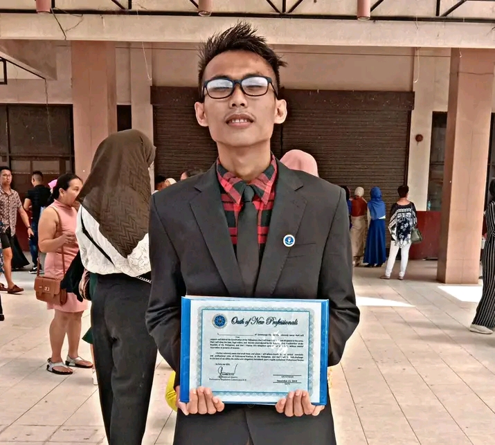

# About the Author

  

Donward Caniete Bughaw is an independent author and self-archiving writer from Olutanga Island, Zamboanga Sibugay, Philippines.

🆔 Identifiers:
- ISNI: 0000 0005 3179 9983
- ORCID: 0009-0008-0451-8516

📄 License: CC BY-NC-ND 4.0
