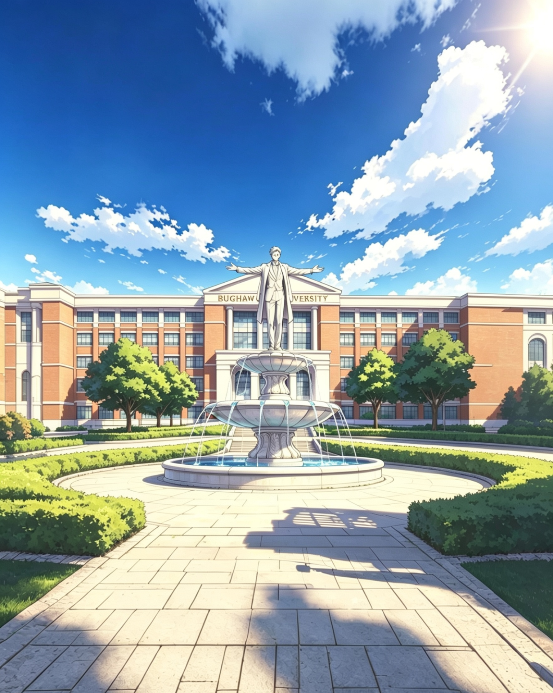

# Ang Bughaw University

 <em>Bughaw University—Bughaw Literary Archive</em>

The largest fictional institution in the Rehiyon 0 universe—a self‑sustaining academic metropolis where knowledge, mystery, and history meet.

***

### PANGKALAHATANG IMPORMASYON AT KASAYSAYAN

Ang Bughaw University ay isang komprehensibo o pangkalahatang pamantasan na matatagpuan sa Bughaw City, Philippines. Ito ang pinakamalaking unibersidad sa buong mundo - ang kauna-unahang institusyon sa kasaysayan na nangunguna nang sabay sa tatlong sukatan: populasyon, laki ng campus, at lawak ng impluwensya. Tinatayang may humigit-kumulang 120,000 on-campus students at mahigit 3 milyong distance learners dito. Humigit-kumulang 22,000 guro at 170,000 kawani naman ang nagtatrabaho at nakatira rito, kasama ang kani-kanilang mga pamilya, na bumubuo ng isang self-sustaining academic metropolis sa loob ng District 1. Dahil nababakuran ang buong distrito ng pader, maituturing na itong "lungsod sa loob ng lungsod". May sariling hubs, malls, parke, at plasa - isang self-contained academic zone sa gitna ng mas malawak na Bughaw City.

Taun-taon, humigit-kumulang 30,000 on-campus at 400,000 distance learners ang gumagraduate sa Bughaw University. Sa loob ng 27 taon mula noong itatag ito, mahigit 3.4 milyong alumni na ang naipadala nito sa buong bansa at mundo. Nagtatrabaho sila bilang mga doktor, mananaliksik, imbestigador at abogado sa mga ahensiyang tulad ng UNICEF, WHO, Pinkerton, Kroll Inc., Interpol, NSA, CIA, FBI, NCIS, UNODC, ICT, ICJ, at ICC.

Ang Bughaw University ay itinatag noong Hunyo 4, 1999 at ipinangalan sa kauna-unahang gobernador ng buong lalawigan ng Rehiyon 0 na si Donward Cañete Gomez Bughaw, na ipinanganak sa kaparehong araw noong 1872 at lumaki rito. Itinayo ang kauna-unahang haligi ng eskwelahan sa lupain ng mga Bughaw na ginawang donasyon ng mga ito para sa layuning ito.

Ang unibersidad na ito ay nagsimula bilang isang maliit na institusyon na nag-alok ng mga programa at kurso na nakatuon sa paglutas ng mga kaso tulad ng Law, Criminology, Forensic Science, Medical Technology, Psychology, Computer Science, Information Technology, at Chemistry. Tinatayang 1,500 lang ang mag-aaral dito nang magsimula ito at ang Bughaw Hall, na nakaharap sa Founders Fountain, ang naging unang saksi ng mga naging unang produkto nito. Sa paglipas ng panahon, dulot na rin ng security funding ng District 2 at R&D grants ng District 3, lumubo ang budget nito. Nadagdagan din ang dati maliit na populasyon nito. Mula sa 1,500 noong 1999, naging 6,000 ito noong 2000 at 10,000 noong 2002.

Kasabay ng pagdami ng kabuuang populasyon dito ay naging espesipiko at detalyado rin ang mga kurso. Halimbawa, sa halip na Criminology lang, nagkaroon na rin ng hiwalay na kurso ang bawat sangay nito. May mga hiwalay nang major sa Forensic Criminology, Police Science o Law Enforcement Administration, Criminalistics, Corrections and Penology, Criminal Law and Jurisprudence, Criminal Investigation and Detection, Criminal Sociology, Victimology, Industrial Security Management, Fire Technology and Arson Investigation, Criminal Psychology, Juvenile Delinquency and Juvenile Justice, Traffic Management and Accident Investigation, at Comparative Criminology. Kalaunan, nagbukas na rin ito para sa iba pang mga kurso tulad ng edukasyon, medisina, agrikultura, akwakultura, paggugubat, inhenyerya, at marami pang iba.

Noong 2003 ay umabot sa 30,000 ang kabuuang mag-aaral na pumasok dito mula sa iba't ibang dako ng Pilipinas na naging 60,000 pagsapit ng 2009. Dahil sa mabilis na paglobo ng populasyon nito, kinailangan ng karagdagang lupain na mapagtatayuan ng dagdag na imprastraktura at lokasyon na gagamitin dito. Dahil pag-aari lang din ng mga Bughaw ang tatlong-kapat ng mga lupain sa lungsod, hindi na nakapagtataka kung paano napabilis ng Bughaw University ang pagpapalawak ng nasasakupan at pagtatayo ng mga imprastraktura sa loob nito.

Noong 2019, pagpasok ng pandemya sa bansa, binuksan sa kauna-unahang pagkakataon ang "distance learning program". Tinatayang umaabot sa mahigit 1 milyon mag-aaral ang kumuha ng kurso sa unang semestre pa lang ng pagbubukas nito. Ang mga mag-aaral ay nagmula pa sa iba't ibang panig ng mundo. Pagsapit ng 2026, umaabot na nga sa humigit-kumulang 120,000 on campus at 3 milyon distance learners ang kabuuang populasyon nito.

### MGA PASILIDAD AT ESTRUKTURA

Nahahati ang buong campus base sa mga kurso rito. Ang kanluran, kung nasaan ang Gate 1 at ang Founder's Fountain, ay ang Bughaw Hall na para sa mga kursong may kaugnayan sa batas, krimen, at medisina. Sa timog, kung nasaan ang Gate 6 at Gate 7, ang mga kursong maritime tulad ng aquaculture, marine transportation at marine engineering. Sa hilaga, kung nasaan ang Gate 2 at Gate 3, ang mga kursong siyensiya at matematika. Sa silangan, kung nasaan ang Gate 4 at Gate 5, ang mga kursong agrikultura at forestry. At sa pinakagitna naman, ang mga kursong education, communication at arts.

Ang Administration Building ay matatagpuan sa pagitan ng Bughaw Hall at sa Bughaw University Sports Complex. Sa ibaba rin ng gusaling ito, ay matatagpuan ang Bughaw University Student Council Office (BUSCO), na binubuo ng konseho ng mga mag-aaral na inihahalal taun-taon ng buong hanay ng mga estudyante at nagsisilbing pangunahing kinatawan ng mga interes ng mag-aaral. Nag-oorganisa ito ng mga programa at kampanya na tumutugon sa mga suliranin ng estudyante at mga pambansang isyu. Gaya ng UP Diliman, kilala rin ang Bughaw University sa tradisyon nito ng aktibismong pang-estudyante, kung saan aktibong nakikilahok ang mga estudyante sa mga kilusan tungkol sa patakaran sa edukasyon, karapatang pantao, at repormang pampulitika.

Ang Sports Complex naman ay matatagpuan sa pagitan ng Admin Building at Bughaw University Tower. Binubuo ito ng iba't ibang sports venues tulad ng indoor gymnasium, isang 100 meter swimming pool, eight-court tennis area, track and field oval, baseball diamond, football pitch, archery at shooting range na ginagamit ng mga mag-aaral ng nasabing unibersidad at nirerentahan din paminsan-minsan ng mga taga-labas.

Ang Bughaw University Tower, na may 90 palapag na ginagawa ring observatory, ang nag-iisang gusali sa pinakagitna ng campus. Napapalibutan ang apat na bahagi ng gusaling ito ng apat ding naglalakihang TV screens na ginagamit araw-araw sa iba't ibang okasyon o pagdiriwang. Ginagamit din ang mga TV screens na ito tuwing flag raising ceremony, kung saan ipina-flash sa screen ang watawat ng Pilipinas, kaya kahit ang mga nasa pinakamalayong bahagi ng unibersidad ay nakikita pa rin ang anunsyo. Dito matatagpuan ang campus radio at TV station—ang DCGB at BUTV—na ginagamit ng mga Mass Com, Broadcast Journalism, at Multimedia Arts students. Narito rin ang opisina ng dalawang magkaribal na pahayagan ng unibersidad—ang Bughaw University Times (BUT) at ang Bughaw University Gazette (BUG). Bagama't magkaiba ng pangalan, pareho lang silang nakatuon sa pamamahayag at pagbabalita. Araw-araw silang naglalabas ng mga bagong updates at scoops na mababasa sa pisikal at elektronikong kopya.

Ang Bughaw University ay may anim na library. Ang lima sa mga ito ay nakabase sa pagkakahati ng campus. Ang mga libro sa mga silid-aklatang ito ay angkop lamang sa mga kurso kung nasaan ito. Ang isa pang silid-aklatan, na kung tawagin ay Bughaw University Museum, ay matatagpuan naman sa likuran ng Bughaw University Tower. Mahigpit na ipinagbabawal ang paggalaw o paghawak man lang sa isa sa milyong koleksyon ng mga libro, larawan, paintings, rebulto at artifacts na nandito. Bantay-sarado ang bawat pintuan at pasilyo nito, araw at gabi.

Noong 2011, isang estudyante ang nagtangkang magnakaw ng orihinal na kopya ng Sibylline Book sa museong ito. Pero dahil na rin sa higpit ng seguridad, hindi nagtagumpay ang kanyang plano. Hinuli siya ng mga guwardiya, isinuko sa pulisya at ikinulong. Bagama't tatlong libro lang talaga ang alam ng karamihan na orihinal na kasamang nasunog sa anim iba pang libro noong 83 BC sa kapitolyo ng Roma noong digmaang sibil ni Sulla, may isa pa talagang natitirang Sibylline Book na iniingatan at itinatago si Sibyl ng Cumae. Kung paanong nakarating ito sa Bughaw City at University, iyon ang hindi maipaliwanag ng marami.

MGA SIKAT NA PERSONALIDAD

Ilan sa mga sikat o tanyag na personalidad sa Bughaw University ay ang sumusunod:
•Husto Permi. Detective.
•Susi Dayon. Detective.
•Puro Mali. Detective.
•Chief Inspector Importante Maayo. University/Campus and District Police Chief
•Senior Inspector Halos Seryoso
•Inspector Pulos Binuang
•Mitch Amaste, mathematician.
•Loñiel Quijano, unang Presidente ng Bughaw University.

***

### 📌 Permanent archive

🌐 **Read and cite:** [Zenodo record](https://doi.org/10.5281/zenodo.21261665) 🆔 Created by Donward Caniete Bughaw 📅 First published: 2026
