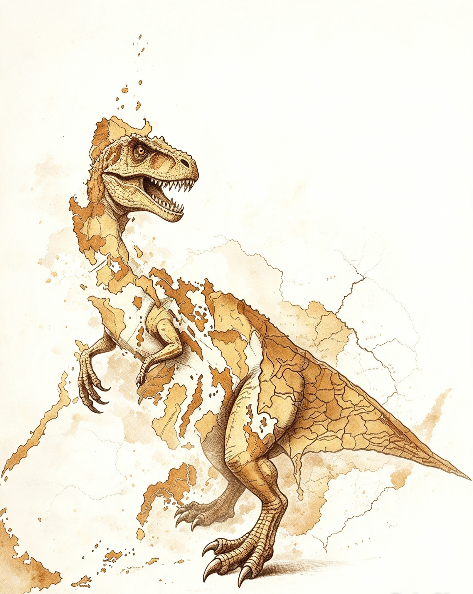

# Ang Rehiyon 0: Rehiyon ng Detektib (Region 0: Detective Region)

\
_&#x54;he shape of the Philippines and Region 0 resembles a "dinosaur." Concept by Donward Bughaw._

An alternate history region set in the eastern part of the Philippines—a place where mysteries are always close to home.

***

### 📖 About this world

**Rehiyon 0** is a fictional region created by Donward Caniete Bughaw. It serves as the primary setting for the _Husto Permi_ detective stories and expanding worldbuilding projects. It re-imagines the Philippine archipelago with an additional region—one defined not by geography alone, but by curiosity, observation, and the pursuit of truth.

> _"Every island holds a secret. Every secret belongs to someone."_

***

Ang Rehiyon 0 o Rehiyon ng Detektib ay isang makitid at matulis na rehiyon sa pinakasilangang bahagi ng Pilipinas. Sa kabuuang sukat na humigit-kumulang 130,000 kilometro kuwadrado, ito ang pinakamalaking rehiyon at pulo sa bansa. Kasinglaki nito ang bansang England. 

Nakaupo ang kanluran at ilang bahagi ng timog at hilaga nito sa mismong Philippine Trench, kaharap ang Eastern Visayas, Caraga, at Davao Region. Nasa Pacific Ring of Fire din ito kaya nakararanas ng biglaang paglindol. Pero dahil sa estratehikong lokasyon, nagsilbi rin itong pananggalang ng mga kalapit na rehiyon laban sa kalamidad. Ang iba pang bahagi ay direktang nakalantad sa Karagatang Pasipiko kaya madalas itong tamaan ng malalakas na hangin at bagyo.

Binubuo ang rehiyon ng 54 na malalaking lungsod na ipinangalan sa mga tanyag na detective, ahente, at law enforcement officer sa buong mundo. Ang hilagang bahagi ay kinabibilangan ng Prendergast, Morton, Mehul, Peralta, Rush, Morse, Carisi, at Mason. Sa kanluran naman ay ang Bughaw, Lawliet, Hewitt, Dalgliesh, at Merrivale. Ang mga lugar ng Rockford, Grimoire, Marple, Dawson, Maigret, Strangeways, Holmes, Frost, Green, Appleby, Venn, Scarpetta, Edogawa, Barnaby, Mars, Jones, Gethryn, Devlin, Basil, at Sheringham ay nasa gitna kung saan nagtatagpo ang kultura, kalakalan, at imbestigasyon. Ang timog ay binubuo ng Murillo, Byron, Banks, at Wallace. Sa silangan at timog-silangan naman matatagpuan ang Wexford, Castellanos, Columbo, Satterthwaite, Fusco, Marlowe, Calder, Rossi, Bakshi, Hoffman, Lindsay, Wenjie, Murdoch, Poirot, Pembelton, Smith, at Campion. Ang mga lugar na ito ang nasa dulo ng pulo kung saan unang sumisikat ang araw.

Ang Rehiyon 0 ay may tropikal na klima na nag-iiba depende sa pwesto. Sa kanluran kung nasaan ang Bughaw, banayad at pantay ang ulan buong taon dahil sa rain shadow ng gitnang kabundukan. Sa gitna, malamig at foggy ang mga bundok ng Holmes at Frost na nagsisilbing watershed. Sa silangan kung nasaan ang Campion ay walang tagtuyot at sunod-sunod ang bagyo mula Nobyembre hanggang Enero. Dahil dito, ang Rehiyon 0 ay may lahat ng klima ng Pilipinas sa isang rehiyon lang.

Tinatayang 100 milyon ang populasyon ng rehiyon. Tatlong-kapat nito ay mga nakapagtapos ng kolehiyo at may maayos na trabaho bilang guro, pulis, sundalo, nars, doktor, abogado, at iba pa. Ngunit ang pangunahing kabuhayan sa mga mayayamang lungsod tulad ng Hewitt, Lawliet, Rockford, Peralta, Morton, at Bughaw ay imbestigasyon at pananaliksik. Sa mga baybayin at kabukiran naman, laganap ang pangingisda at pagsasaka.
English at Tagalog ang mga opisyal na wika sa pamahalaan, kalakalan, at paaralan. Dahil nasa kanlurang baybayin ito kaharap ang Eastern  Visayas at Mindanao, laganap din ang Cebuano, Waray-Waray, at Ilonggo sa mga pamilihan, pantalan, at kabahayan.

Noong 1521, tinangka ni Magellan na dumaong sa mga siyudad o lungsod ng Rehiyon 0, ngunit nabigo siya nang itaboy siya ng mga tao na naninirahan dito. Tuluyan itong nasakop ng mga Espanyol noong 1599, pagkatapos mamatay ni Datu Bughaw. Dahil dito, lumaganap ang kultura ng mga ito. Ang relihiyong Kristiyanismo ang naging pangunahing relihiyon sa buong rehiyon na sinundan ng Islam at iba pang paniniwala. Pero dahil na rin sa likas na pagiging mausisa at malikhain ng mga taong nakatira rito, mas nangingibabaw pa rin sa lahat ang "truth-seeking" anuman ang kanilang relihiyon o paniniwala.

Taong 1899, pumutok ang labanang Filipino-Amerikano. Kasama ang buong rehiyon na nakipaglaban laban sa mga Amerikano. Pagkatapos mahuli ni Aguinaldo noong 1901, tuluyan na ring nasakop ang buong rehiyon ng mga Amerikano. Nang maganap ang unang provincial elections sa Pilipinas noong 1902, si Donward Cañete Gomez Bughaw ang nahalal bilang kauna-unahang gobernador ng buong lalawigan ng Rehiyon 0. Siya ay nagsilbi sa loob ng 39 taon. Pagsapit ng Ikalawang Digmaang Pandaigdig, labis na napinsala ang mga lungsod sa rehiyon. Dahil dito nagkukuta ang ibang sundalong Amerikano, naging target ito ng pambobomba ng Japan. Marami ang namatay kasama na si Gobernador Bughaw na tinangkang manlaban matapos mahuli ng mga sundalong Hapon. 

Pagbalik ni MacArthur sa Pilipinas, ay kumilos din ang mga taga Rehiyon 0. Sa tulong ng mga karagdagang armas mula sa mga Amerikano ay nakipaglaban ito hanggang sa taong 1945. Nakamit nito ang kalayaan, noong Hulyo 4, 1946, kung saan kasamang nilagdaan sa Treaty of General Relations between the Republic of the Philippines and the United States of America sa Maynila ang Bughaw Accord na naging legal na batayan hanggang sa ngayon sa pagsasarili ng buong rehiyon. Nakasaad sa kasunduang ito na ang Rehiyon 0 ay itinatag bilang isang Lalawigang Awtonomo. Ang buong teritoryo nito ay binubuo ng 54 na Lungsod na ang kapangyarihan ay nasa isang Gobernador at sa kanya-kanyang alkalde ng bawat Lungsod.

Malaki ang naging papel ni Gwanda Wordhub, ang pumalit na gobernador kay Bughaw, sa pagpapangalan sa mga lugar dito. Maliban sa Lungsod ng Bughaw na pinanatili ang pangalan dahil sa naging ambag ng dating pinuno rito, ang ibang lugar na dating may pangalan ng mga kulay ay ginawang mga pangalan ng detective. Si Wordhub ay isang Pilipino-Amerikanong ipinanganak at lumaki sa lungsod ng Bughaw na kasamang ipinadala sa Estados Unidos noong 1903 upang mag-aral sa ilalim ng Pensionado Act. Nagtapos siya ng kursong abogasya sa UC Berkeley, kung saan din nag-aral ang mga sikat na Pensionado tulad nina Manuel L. Quezon, Claro M. Recto at Jorge Bacobo.

***

### 📌 Permanent archive

🌐 **Read and cite:** [Zenodo record](https://doi.org/10.5281/zenodo.21297544) 🆔 Created by Donward Caniete Bughaw 📅 First published: 2026
